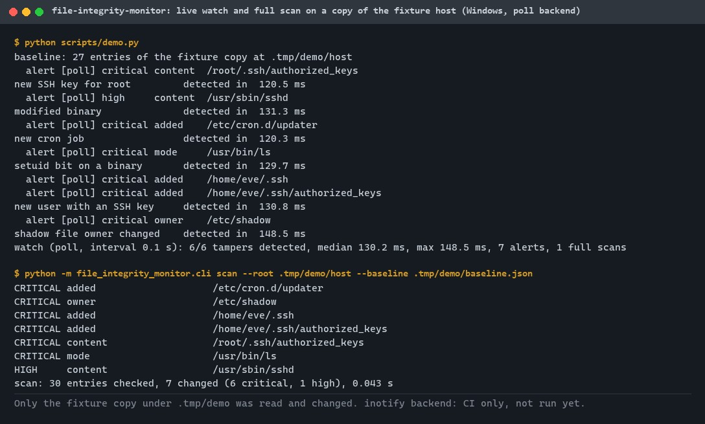
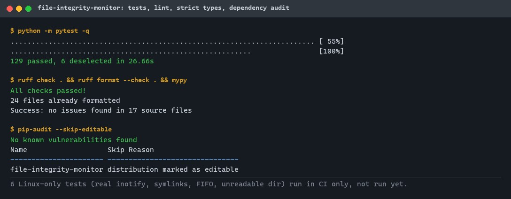
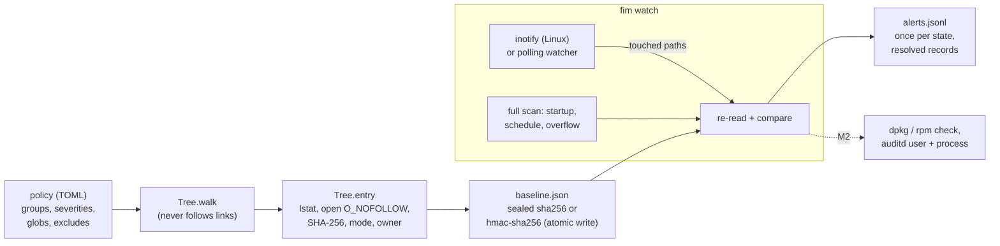
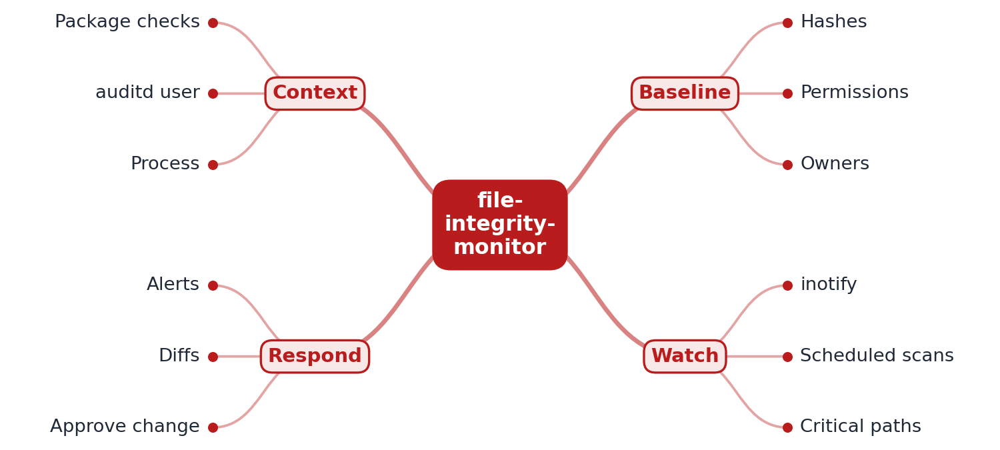

# file-integrity-monitor

[](https://github.com/EquinoxWN/file-integrity-monitor/actions/workflows/ci.yml)


> Unauthorized changes to system files can go unnoticed for months: detect them on Linux in real time, without alerting on every package update.

Part of my **Cyber Security** list · Python · Linux · core project

## Proof it works

On a copy of the fixture host, `fim` records a sealed baseline (27 entries), then the monitor
runs while six intrusion steps are applied: a new SSH key for root, a modified `sshd`, a new cron
job, a setuid bit on `ls`, a new user with an SSH key and an ownership change on `/etc/shadow`.
All six were detected by the live watcher (portable polling backend at 0.1 s, median 130 ms on
the author's Windows machine), and the full scan afterwards reports exactly the changed paths.
Only the fixture copy under `.tmp/demo` was read and changed; the machine's own files were never
read. The inotify backend is Linux-only and runs in CI (not run yet):



129 tests pass locally (policy, tree reads, sealing, change detection, inotify event decoding,
the monitor and the CLI end to end); lint, strict types and the dependency audit are clean.
Six Linux-only tests (real inotify, symlinks, a FIFO, an unreadable directory) run in CI:



## Architecture

**What M1 runs today:**



**Full roadmap (M1 to M3):**



## How it works

_Steps 1 and 2 are built and tested (M1; the inotify backend runs in CI only); the rest is on the [roadmap](#roadmap)._

1. A baseline records hashes, permissions and owners of critical files (binaries, configs, cron, SSH keys).
2. inotify watches those paths for real-time changes; scheduled scans catch anything missed.
3. Changes are checked against the package manager, so legitimate updates aren't flagged.
4. auditd records which user and process made each change.
5. Alerts show a diff for text files, and approved changes update the baseline.
6. A lab simulates unauthorized changes (a new SSH key, a modified binary, a new cron entry) to test detection.

What M1 records and reports:

| Part | Behaviour |
|---|---|
| Policy | TOML groups with a severity (`low` to `critical`), path patterns with per-component globs (`/home/*/.ssh`), `recursive`, file-name `exclude`s; strictly validated. A path belongs to the most severe group covering it. The bundled policy covers SSH keys, accounts and sudoers, cron and systemd units, binaries (one level) and selected configuration |
| Entry | kind (file, dir, symlink, other), mode including setuid/setgid/sticky, uid, gid, and for files size and SHA-256; for links the target. Links are never followed; FIFOs and devices are never opened; a file swapped between `lstat` and `open` is an error |
| Baseline | JSON with the policy and all entries, sealed with SHA-256 or, with `--key-file`, HMAC-SHA256; a keyed baseline is never accepted with a plain digest; written atomically |
| Changes | `added`, `removed`, `type`, `content`, `link_target`, `mode`, `owner`, `unreadable`; severity raised to critical when a setuid, setgid or world-writable bit appears |
| Watch | full scan at start, then watcher events re-read only the touched paths (and walk new directories), a full scan every `--rescan-every` seconds and on inotify queue overflow; each state is alerted once, `resolved` is logged when a path is back to the baseline, and the log is replayed on restart |

Exit codes: 0 no change, 1 changes or alerts, 2 bad input (policy, baseline, seal, key, root),
3 a read or inotify error; `fim baseline` also exits 3 when an entry could not be read.

## Who it helps

- **Who:** Linux administrators and security engineers looking after a few to a few hundred servers.
- **The problem:** an extra key in `authorized_keys`, a new cron job or a replaced binary can sit unnoticed for months, and daily scans alone leave a long window.
- **How to use it:** run `fim baseline` on a known-good host (keep the HMAC key and a copy of the baseline off the host), then `fim watch` to get an alert line within about a second of a change to a covered file, with full scans as the safety net; `fim scan` gives the same comparison on demand or from cron.

## Tech stack

| Area | In M1 | Planned |
|---|---|---|
| Core | Python 3.11+, standard library only (`tomllib`, `hashlib`, `hmac`, `ctypes`, `select`) | |
| Baseline | SHA-256 of files, mode, uid, gid, link targets; sealed JSON (SHA-256 or HMAC-SHA256) | Approved changes update the baseline (M3) |
| Watch | inotify via ctypes (Linux, CI only so far), portable polling watcher, scheduled and overflow full scans | |
| Context | | Package-manager verification with dpkg / rpm (M2), auditd user and process (M2) |
| Output | Text lines, JSON scan report (atomic), append-only JSON-lines alert log | Diffs for text files (M3) |
| Lab | Fixture host tree with a stat manifest; six simulated intrusion steps in tests and `scripts/demo.py` | VM lab with package-update false-alert rate (M3) |

Language: **Python** (3.11+). Code in [`src/file_integrity_monitor/`](src/file_integrity_monitor): policy (`policy.py`), tree reads and hashing (`tree.py`), the sealed baseline (`baseline.py`), change detection (`compare.py`), inotify (`inotify.py`), the monitor and alert log (`monitor.py`) and the CLI (`cli.py`); the bundled policy is in [`policies/`](src/file_integrity_monitor/policies).

## Run it

**Prerequisites:** Python 3.11+. `fim watch` with inotify and `--root /` need Linux; run as root
to read files such as `/etc/shadow`. Off Linux, `--root` must be a fixture directory (a drive
root is refused) and `watch` uses the polling backend. No environment variables are read;
everything is a flag.

```bash
python -m venv .venv && source .venv/bin/activate   # Windows: .venv\Scripts\activate
make setup        # install the package and dev tools
make lint         # ruff, ruff format, mypy --strict
make test         # 129 tests (Linux-only tests are deselected)
make test-linux   # 6 more on Linux: real inotify, symlinks, FIFO (CI runs this)
make demo         # baseline, live watch and six tampering steps on a copy under .tmp/demo
make audit        # pip-audit
```

On a Linux host:

```bash
head -c 32 /dev/urandom > /secure/fim.key          # keep a copy off the host
sudo fim baseline --out /var/lib/fim/baseline.json --key-file /secure/fim.key
sudo fim scan --baseline /var/lib/fim/baseline.json --key-file /secure/fim.key --json changes.json
sudo fim watch --baseline /var/lib/fim/baseline.json --key-file /secure/fim.key \
     --alerts /var/log/fim/alerts.jsonl --rescan-every 3600
fim policy check my-policy.toml                    # validate your own policy
```

On a fixture tree (what this repository tests): `fim baseline --root tests/fixtures/host --out .tmp/b.json`.
A fixture tree may hold `.fim-meta/stat.tsv` (`mode<TAB>uid<TAB>gid<TAB>path`, as from
`stat -c '%a\t%u\t%g\t%n'`) because a Windows checkout cannot hold Linux modes and owners.

A policy group:

```toml
version = 1

[[group]]
name = "ssh-keys"
severity = "critical"          # low | medium | high | critical
paths = ["/root/.ssh", "/home/*/.ssh", "/etc/ssh"]
recursive = true               # false: the path and its direct children
exclude = ["*.swp"]            # file-name patterns
```

## Tests and results

Full numbers and commands: [docs/results/m1.md](docs/results/m1.md). The 10-rule quality check (failure paths, retry safety, mutation testing) is in [docs/quality/2026-11-01.md](docs/quality/2026-11-01.md).

| Check | Result |
|---|---|
| Tests (`make test`) | **129 passed** locally, 0 failed; 6 Linux-only tests deselected (CI only, not run yet) |
| Simulated intrusion (`test_scan_finds_exactly_the_simulated_tampering`) | exactly the 5 tampered paths reported, with the expected kinds and severities; an uncovered change (`/etc/hostname`) is ignored |
| Live watch, polling backend at 0.1 s (`scripts/demo.py`, Windows, 3 runs) | 6 of 6 tampering steps detected in each run; median 130, 443 and 146 ms, max 149, 1021 and 150 ms (the slow run had six other builds running) |
| Live watch, inotify backend | CI only, not run yet |
| Mutation testing | 14 of 14 hand mutants killed (12 by the first suite, 2 after adding tests) |
| Lint / audit | ruff, mypy `--strict` clean; `pip-audit`: no known vulnerabilities |

| Test file | Tests | What it proves |
|---|---|---|
| `test_policy.py` | 33 | bundled policy loads; recursive and one-level coverage, globs, excludes, most severe group wins (first on ties), pattern ancestors; 16 malformed policies and 9 unsafe paths rejected with a reason; file size, encoding and missing-file errors |
| `test_tree.py` | 23 (+3 in CI) | SHA-256, size and manifest mode/owner; manifest reloaded on change; 3 MiB file hashed in chunks; a swapped file is an error; globs; the walk covers the policy, skips uncovered files and the manifest, walks new directories, stops at one level, refuses more than the cap; off-Linux drive root refused; manifest and entry parsing errors. CI: symlink not followed, FIFO not opened, unlistable directory reported |
| `test_baseline.py` | 14 | round trip; any edit breaks the seal; HMAC needs the right key; a keyed baseline re-sealed with a plain digest is refused; malformed and duplicate content; atomic and identical rewrites; a failed write keeps the old file; key and file errors |
| `test_compare.py` | 20 | each change kind, added/removed/link target, uncovered paths ignored, group severity, escalation on new setuid/setgid/world-write (not on removal), sort order, stable state ids |
| `test_inotify.py` | 10 (+3 in CI) | event records decoded with padding, truncated records rejected; events mapped to paths; overflow, new directories and dropped watches flagged; watch set includes pattern ancestors; refused off Linux. CI: a modified file, a new user's new key, an atomic rename over `/etc/passwd` |
| `test_monitor.py` | 14 | polling watcher reports added, modified, removed and owner changes once; one alert per state, resolve and re-alert; removed directories report every path below; new directories are walked; a same-size change with the mtime restored is missed by polling and caught by the full scan; the alert log replay prevents duplicates after a restart; four concurrent checks give one alert; startup, scheduled and overflow scans |
| `test_cli.py` | 15 | baseline and clean scan; the simulated intrusion end to end with the JSON report; `watch` with the poll backend writes the alert log and adds nothing on restart; HMAC round trip and wrong key; an edited baseline exits 2; `policy check`; bad input exits 2; off-Linux refusals |

## Roadmap

**M1** (≈15 h)
- [x] Write `docs/rfc/0001-design.md`: problem, goals, non-goals, chosen design
- [x] A baseline records hashes, permissions and owners of critical files (binaries, configs, cron, SSH keys).
- [x] inotify watches those paths for real-time changes; scheduled scans catch anything missed. (inotify itself is tested in CI only, not run yet.)

**M2** (≈20 h)
- [ ] Changes are checked against the package manager, so legitimate updates aren't flagged.
- [ ] auditd records which user and process made each change.

**M3** (≈25 h)
- [ ] Alerts show a diff for text files, and approved changes update the baseline.
- [ ] A lab simulates unauthorized changes (a new SSH key, a modified binary, a new cron entry) to test detection.
- [ ] Publish the proof below with real numbers

## Proof

What this repo must show before it counts as done:

- Detection of simulated tampering in the lab, and the false-alert rate during normal package updates.

| Result | Value |
|---|---|
| M3 proof above | Not measured yet (M3). Current M1 numbers: see [Tests and results](#tests-and-results). |

## Why it matters

- **Interview angle:** 'How would you know a server had been tampered with?' host-security questions.
- **Upstream I'd like to contribute to:** AIDE or osquery: docs or tests.

## Design docs

- [RFC 0001: design](docs/rfc/0001-design.md)
- [ADR 0001: record architecture decisions](docs/adr/0001-record-architecture-decisions.md)
- [ADR 0002: a real-time watcher plus scheduled full scans](docs/adr/0002-watcher-plus-scheduled-full-scan.md)
- [ADR 0003: a sealed JSON baseline with an optional HMAC key](docs/adr/0003-sealed-json-baseline.md)
- [M1 results](docs/results/m1.md)
- [Quality check (10 rules)](docs/quality/2026-11-01.md)

## Scope

This is a learning and portfolio system, not a hosted production service. The monitor only reads
the trees it watches. Known limits: a root attacker can stop the monitor and, if the HMAC key is on
the same host, rewrite the baseline and the alert log; until M2 every package update of a covered
file is an alert; the polling backend misses a same-size change with a restored mtime until the
next full scan; inotify, symlink and FIFO handling are tested in CI only (not run yet), and the
author's machine was never monitored.

## Security and contributing

- Every GitHub Action is pinned to a commit SHA; workflows run read-only, without persisted credentials.
- Dependabot update pull requests are paused (`open-pull-requests-limit: 0`) so the repository keeps a single `main` branch; dependencies are updated by hand and checked by the CI audit.
- Files are opened read-only with `O_NOFOLLOW` after `lstat`, and the open file must match it; policies, manifests, baselines and alert logs are size-capped and validated; no runtime dependencies.
- Report vulnerabilities privately: see [SECURITY.md](SECURITY.md). To contribute, see [CONTRIBUTING.md](CONTRIBUTING.md).

## License

MIT, see [LICENSE](LICENSE).
